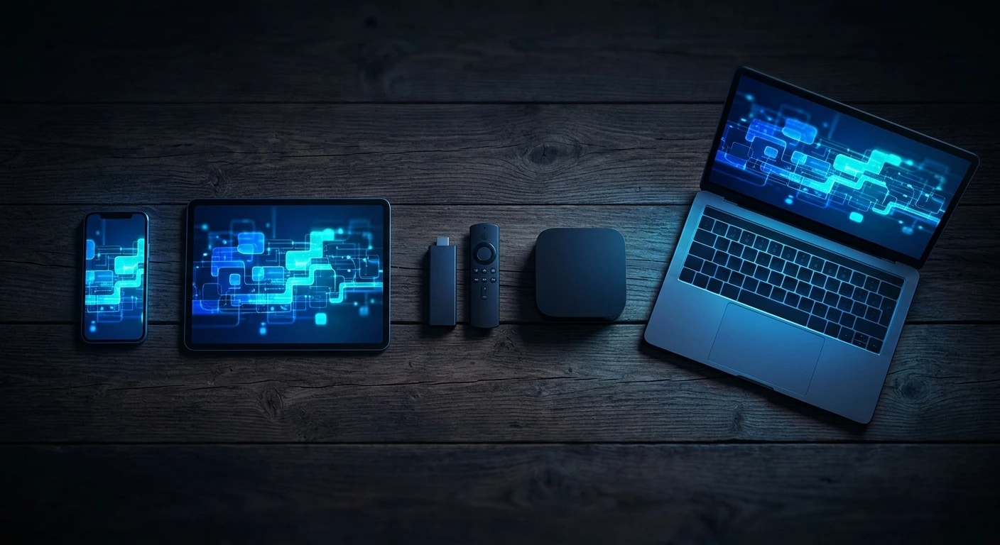
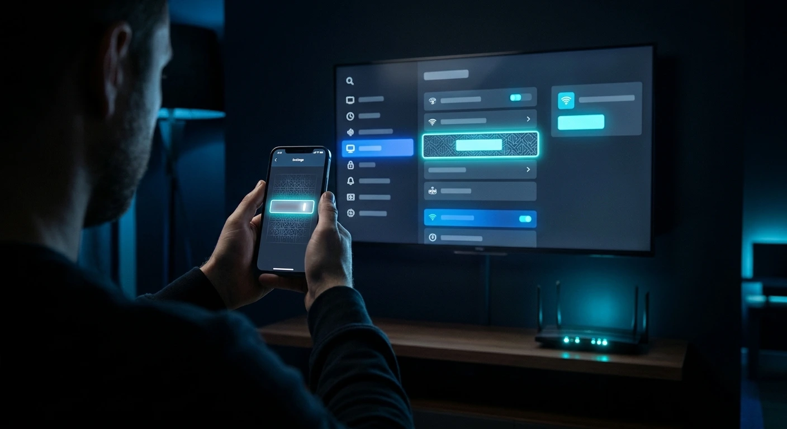

**Net IPTV aktivieren in Kurzform: Du wählst ein Abo, öffnest die Willkommensmail, die etwa 60 Sekunden nach der Zahlung ankommt, installierst eine Player-App auf deinem Gerät und meldest dich mit den Daten aus dieser Mail an – oder schickst dem Support die MAC-Adresse deines Geräts.** Auf den meisten Geräten dauert das Ganze keine fünf Minuten, und technisches Vorwissen brauchst du dafür nicht.

Diese Anleitung deckt alle unterstützten Geräte ab, in der Reihenfolge, in der die meisten sie einrichten: Smart TVs, Fire TV Stick, Android und iOS, MAG-Boxen sowie Windows oder macOS. Außerdem findest du die fünf häufigsten Ursachen für ein „Es geht nicht“ – so behebst du sie in einer Minute selbst. Wenn du lieber zuerst die Kurzfassung pro Gerät sehen möchtest: Auf unserer [Seite mit den unterstützten Geräten](/de/devices) gibt es kurze Schrittlisten für jede Plattform.

## Schnelle Antworten

- [Was brauche ich, bevor ich loslege?](#was-du-vor-dem-start-brauchst)
- [Welche Player-App sollte ich nutzen?](#welche-player-app-für-welches-gerät)
- [Was, wenn die Aktivierungsmail nicht ankommt?](#die-5-häufigsten-aktivierungsprobleme-beheben)
- [Kann ich es auf zwei Fernsehern nutzen?](#net-iptv-auf-mehreren-geräten-aktivieren)

## Was du vor dem Start brauchst

Um Net IPTV zu aktivieren, brauchst du drei Dinge: ein aktives Abo oder einen Testzugang, die Willkommensmail mit deinen Zugangsdaten und ein kompatibles Gerät an einer Leitung mit mindestens 8 Mbit/s. Leg dir das vorher bereit, dann dauert die Einrichtung selbst auf keinem Bildschirm im Haus länger als fünf Minuten.

- **Ein Abo oder ein Testzugang.** Wähle auf der Preisseite ein Abo für 1, 3, 6 oder 12 Monate oder frag den Support per WhatsApp nach einem kostenlosen Testzugang. Ein Testzugang wird genauso eingerichtet wie ein bezahltes Konto, alles in dieser Anleitung gilt also für beide.
- **Deine Willkommensmail.** Sie enthält Benutzername, Passwort und Einrichtungslinks. Je nach Gerät nutzt du entweder die Zugangsdaten, eine Portal-URL, einen M3U-Playlist-Link oder gar nichts davon (bei MAC-basierten Apps).
- **Ein unterstütztes Gerät.** Smart TVs von Samsung und LG, Android TV und Google TV, Amazon Fire TV Stick, Apple TV, iPhone und iPad, Android-Smartphones und -Tablets, MAG-Boxen, Windows- und macOS-Computer sowie Xbox und PlayStation.
- **Genug Bandbreite.** Etwa 8 Mbit/s pro Stream für HD, 15 Mbit/s für Full HD und 25 Mbit/s für stabiles 4K. Der Player passt die Bitrate automatisch an – bei einer langsameren Leitung sinkt also die Qualität, statt dass die Wiedergabe abbricht.

Halte dein Smartphone griffbereit. Auf mehreren Geräten ist der schnellste Weg, dem Support ein Foto vom Fernsehbildschirm per WhatsApp zu schicken.

## So aktivierst du Net IPTV (Schritt für Schritt)

Die Aktivierung von Net IPTV folgt auf jedem Gerät denselben fünf Schritten: Abo holen, Willkommensmail öffnen, Player installieren, anmelden oder MAC-Adresse senden und schließlich Sender und TV-Guide laden. Nur Schritt vier unterscheidet sich je nach Gerät, und die folgenden Abschnitte erklären jede Variante.

1. **Abo wählen oder Testzugang starten.** Such dir dein Abo auf der Preisseite aus oder schreib dem Support für einen Testzugang ohne Kartendaten.
2. **Willkommensmail öffnen.** Nach der Zahlungsbestätigung wird automatisch eine E-Mail mit deinen Zugangsdaten und einer Einrichtungsanleitung verschickt, meist innerhalb von 60 Sekunden. Heb sie auf, denn du brauchst sie wieder, wenn du ein zweites Gerät hinzufügst.
3. **Player installieren.** Jedes Gerät nutzt eine andere Player-App – mehr dazu im nächsten Abschnitt.
4. **Anmelden oder MAC-Adresse senden.** Entweder tippst du die Daten aus der E-Mail in die App ein, oder du schickst dem Support die MAC-Adresse, die die App anzeigt, damit er die Playlist mit deinem Gerät verknüpft.
5. **Sender und Guide laden.** Starte die App neu. Live-Sender, Filme und Serien erscheinen in getrennten Bereichen, und der TV-Guide (EPG) lädt zusammen mit der Playlist.

## Welche Player-App für welches Gerät

Net IPTV läuft über eine Player-App, die du auf deinem Gerät installierst. Welcher Player der richtige ist, hängt von der Plattform ab: MAC-basierte Apps auf Smart TVs und Smartphones, ein Player mit Login auf dem Fire TV Stick, das integrierte Portal auf MAG-Boxen und VLC oder MyIPTV Player auf Computern.

| Gerät | Player | So aktivierst du | Typische Dauer |
|---|---|---|---|
| Samsung / LG Smart TV | Smart IPTV oder IBO Player | MAC-Adresse an den Support senden | 3 Min. |
| Amazon Fire TV Stick | Player aus deiner Willkommensmail | Benutzername und Passwort | 4 Min. |
| Android und iOS | IBO Pro Player oder IBO Player | MAC-Adresse und Geräte-ID senden | 2 Min. |
| MAG-Box | Integriertes Portal | Portal-URL aus deiner E-Mail | 5 Min. |
| Windows / macOS | VLC oder MyIPTV Player | M3U-Playlist-Link | 5 Min. |

Player-Apps stammen von unabhängigen Entwicklern, und manche verlangen für ihre Premium-Funktionen eine kleine Aktivierungsgebühr. Diese Gebühr geht an den App-Entwickler, nicht an Net IPTV, und ist unabhängig von deinem Abo.

## Smart TV: Samsung und LG

Auf Smart TVs von Samsung und LG wird Net IPTV über die MAC-Adresse aktiviert. Du installierst einen Player aus dem App-Store des Fernsehers, die App zeigt beim ersten Start eine MAC-Adresse an, und der Support verknüpft deine Playlist mit dieser Adresse. Samsung (Tizen) und LG (webOS) funktionieren dabei gleich.

1. Öffne den App-Store auf deinem Fernseher und installiere **Smart IPTV** oder **IBO Player**.
2. Starte die App und notiere dir die angezeigte **MAC-Adresse**. Am einfachsten machst du ein Foto mit dem Smartphone, so vermeidest du Tippfehler.
3. Schick diese MAC-Adresse per WhatsApp oder Live-Chat an den Support.
4. Sobald der Support bestätigt, startest du die App neu. Deine komplette Senderliste lädt automatisch.

Zeigt der Fernseher nach einem Software-Update oder einem Zurücksetzen auf Werkseinstellungen eine andere MAC-Adresse an, schick dem Support die neue – er zieht deine Playlist dann um.

## Amazon Fire TV Stick

Der Fire TV Stick nutzt keine MAC-Adresse. Stattdessen erlaubst du Apps außerhalb des Amazon Appstore, installierst den Player über die App Downloader mit dem Link aus deiner Willkommensmail und meldest dich mit Benutzername und Passwort an. Das funktioniert auf dem Fire TV Stick, dem Fire TV Stick 4K und dem 4K Max.

1. Geh zu **Einstellungen → Mein Fire TV → Entwickleroptionen** und aktiviere Apps unbekannter Herkunft (bei neueren Modellen erlaubst du das für die App Downloader).
2. Installiere **Downloader** aus dem Amazon Appstore.
3. Öffne Downloader und gib den Link aus deiner Willkommensmail ein, um den Player zu installieren.
4. Öffne den Player und melde dich mit **Benutzername und Passwort** an.
5. Wähle eine Kategorie und leg los.

Siehst du die Entwickleroptionen nicht, öffne **Einstellungen → Mein Fire TV → Info** und wähle mehrmals den Gerätenamen aus, bis eine Meldung bestätigt, dass der Entwicklermodus aktiv ist.

## Android- und iOS-Smartphones und -Tablets

Auf Android sowie iPhone oder iPad dauert die Aktivierung etwa zwei Minuten. Du installierst IBO Pro Player oder IBO Player aus Google Play oder dem App Store, schickst dem Support einen Screenshot mit deiner MAC-Adresse und Geräte-ID, und der Support fügt die Playlist für dich zu deinem Gerät hinzu.

1. Installiere **IBO Pro Player** oder **IBO Player** aus Google Play oder dem App Store.
2. Öffne die App und mach einen Screenshot des Bildschirms mit **MAC-Adresse und Geräte-ID**.
3. Schick den Screenshot an den Support.
4. Die Mediathek synchronisiert sich in wenigen Sekunden und ist dann im WLAN oder über mobile Daten bereit.

Behalte bei mobilen Daten den Verbrauch im Blick: Eine Stunde HD verbraucht mehrere Gigabyte. Wenn du die Qualität in den Einstellungen des Players senkst, reicht dein Datenvolumen deutlich länger.

## MAG-Box, Windows und macOS

MAG-Boxen verbinden sich über eine Portal-URL, Computer nutzen einen M3U-Playlist-Link – beides steht in deiner Willkommensmail. Diese Einrichtung dauert etwas länger, rund fünf Minuten, weil das Portal bzw. die Playlist beim ersten Mal vollständig laden muss.

**MAG-Box (MAG 524, 544 und ähnliche):**

1. Geh zu **Einstellungen → Server → Portale**.
2. Gib die Portal-URL aus deiner Willkommensmail ein.
3. Starte die Box neu, damit das Portal aktualisiert wird.
4. Sender, Filme und Serien erscheinen in getrennten Reitern.

**Windows und macOS:**

1. Installiere [VLC](https://www.videolan.org/vlc/) oder MyIPTV Player.
2. Lade den **M3U-Playlist-Link** aus deiner Willkommensmail (in VLC: *Medien → Netzwerkstream öffnen*).
3. Warte, bis die Playlist geladen ist. Große Mediatheken können beim ersten Mal eine Minute brauchen.

## Net IPTV auf mehreren Geräten aktivieren

Du kannst den Player auf beliebig vielen Geräten installieren, aber wie viele davon gleichzeitig streamen können, hängt von deinem Abo ab. Das Monatsabo umfasst eine Verbindung, die 3- und 6-Monats-Abos jeweils zwei und das Jahresabo vier.

Richte jedes weitere Gerät genau wie oben beschrieben ein und nutze dafür dieselbe Willkommensmail. Bei MAC-basierten Apps schickst du dem Support die MAC-Adresse jedes Geräts. Die Zugangsdaten sind für deinen eigenen Haushalt gedacht; wer gleichzeitig mehr Streams nutzt, als das Abo enthält, riskiert eine vorübergehende Sperre – buch also lieber Verbindungen dazu, statt eine zu überdehnen. Auf der Preisseite kannst du die Verbindungen pro Abo vergleichen, bevor du upgradest.

## Die 5 häufigsten Aktivierungsprobleme beheben

Die meisten Aktivierungsprobleme haben eine von fünf Ursachen: Die E-Mail ist im Spam gelandet, die MAC-Adresse wurde falsch eingegeben, die Daten wurden mit einem zusätzlichen Leerzeichen kopiert, der TV-Guide muss aktualisiert werden oder das WLAN ist für die gewählte Qualität zu schwach. Jede davon ist in einer Minute behoben.

1. **Keine Willkommensmail.** Schau zuerst im Spam- und Werbung-Ordner nach. Ist sie nach fünf Minuten nicht da, schreib dem Support mit der E-Mail-Adresse, die du beim Bezahlen angegeben hast, und er schickt sie dir erneut.
2. **MAC-Adresse wird nicht erkannt.** In MAC-Adressen verwechselt man schnell die Ziffern 0 und 1 mit den Buchstaben O und I. Schick lieber ein Foto vom Bildschirm, statt sie abzutippen.
3. **„Invalid login“ auf Fire TV oder Computern.** Beim Kopieren und Einfügen kann am Anfang oder Ende von Benutzername oder Passwort ein Leerzeichen hängen bleiben. Tipp beides von Hand ein und achte genau auf Groß- und Kleinschreibung.
4. **Leerer TV-Guide.** Der EPG lädt automatisch mit der Playlist. Wirkt er leer, aktualisiere den EPG in den Einstellungen des Players und stell die richtige Zeitzone ein – das löst das Problem fast immer.
5. **Ruckeln in 4K.** Verbinde den Fernseher mit dem 5-GHz-WLAN oder per Netzwerkkabel oder geh auf Full HD runter. 4K braucht etwa 25 Mbit/s pro Stream.

Fällt ein einzelner Sender aus, melde seinen Namen im Live-Chat. Die meisten Ausfälle liegen beim Anbieter des Signals und sind nach wenigen Minuten behoben; für große Sender gibt es außerdem Ersatzquellen.

## Was du nach der Aktivierung tun solltest

Sobald alles läuft, machen drei Einstellungen den Alltag spürbar angenehmer: Favoriten anlegen, die 7-Tage-Catch-up-Funktion bei großen Sendern ausprobieren und Audio- und Untertitelsprache prüfen. Jede davon ist in einem Moment erledigt, funktioniert in jeder Player-App gleich und spart dir jeden Abend Zeit, sobald dein Net-IPTV-Abo läuft.

- **Favoriten.** In den meisten Playern kannst du Sender mit einem Stern markieren, damit sie ganz oben erscheinen – praktisch bei einem Angebot von 22.000+ Live-Sendern.
- **Catch-up.** Große Sender bieten 7-Tage-Catch-up, sodass du im Guide zurückscrollen und alles aus der vergangenen Woche abspielen kannst.
- **Audio und Untertitel.** Mehrsprachiger Ton und Untertitel sind bei vielen Sendern und Titeln verfügbar; du wechselst sie im Wiedergabemenü des Players.

Alle anderen Fragen beantwortet wahrscheinlich unsere [FAQ](/de/faq), und der Support ist rund um die Uhr per [WhatsApp oder Live-Chat](/de/contact) erreichbar.

## Fazit

Net IPTV zu aktivieren, läuft auf drei Dinge hinaus: die Willkommensmail, den richtigen Player für dein Gerät und entweder eine Anmeldung oder eine MAC-Adresse, die du an den Support schickst. Das gilt für Smart TVs, Fire TV Stick, Android, iPhone, MAG-Boxen und Computer – meist in weniger als fünf Minuten. Falls du dich noch nicht für ein Abo entschieden hast, vergleiche die Tarife auf der [Preisseite](/de/pricing) oder frag nach einem kostenlosen Testzugang und geh diese Anleitung zuerst auf deinem eigenen Fernseher durch.
