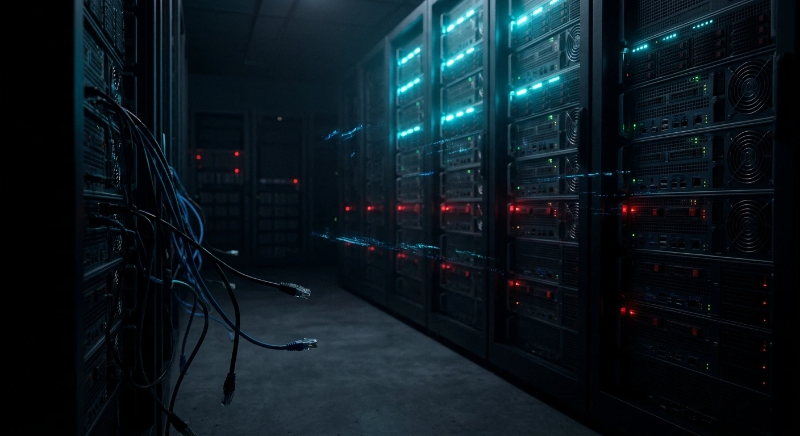

**IPTV in Deutschland in einem Satz: Die Technik ist völlig legal, das Schauen eines unlizenzierten IPTV-Streams aber nicht – und 2026 ist das Jahr, in dem die Strafverfolgung aufgeholt hat.** IPTV bedeutet einfach Fernsehen über deine Internetverbindung, und genau so schauen Millionen deutscher Haushalte bereits MagentaTV, waipu.tv oder Zattoo. Das rechtliche Risiko liegt darin, *woher* der Stream kommt: Ein Anbieter ohne die Rechte an Bundesliga-, Sky- oder DAZN-Inhalten verkauft etwas, das er legal gar nicht verkaufen darf, und seit 2017 behandelt das EU-Recht das Schauen solcher Streams nicht mehr als harmlos.

Dieser Ratgeber richtet sich an alle, die in Deutschland leben – auch an Expats, Studierende und internationale Familien – und die Regeln verstehen wollen, bevor sie sich für ein TV-Setup entscheiden. Er behandelt die Rechtslage, die Razzien von 2026, wer die Fußballrechte tatsächlich hält, und eine Checkliste, mit der du jeden Anbieter beurteilen kannst, uns eingeschlossen. Er ist Teil unseres umfassenderen Ratgebers zum Thema [Fernsehen aus der Heimat im Ausland schauen](/de/blog/watch-tv-abroad).

## Schnelle Antworten

- [Ist IPTV in Deutschland legal?](#ist-iptv-in-deutschland-legal)
- [Was hat die Operation Kratos 2 verändert?](#was-die-operation-kratos-2-für-zuschauer-in-deutschland-bedeutet)
- [Wer zeigt die Bundesliga 2026/27?](#wer-die-bundesliga-202627-in-deutschland-zeigt)
- [Wie prüfe ich einen IPTV-Anbieter, bevor ich zahle?](#so-prüfst-du-einen-iptv-anbieter-bevor-du-zahlst)

## IPTV in Deutschland einfach erklärt

IPTV ist in Deutschland ganz normales, lizenziertes Fernsehen. MagentaTV von der Deutschen Telekom, Vodafone GigaTV, waipu.tv und Zattoo liefern Live-Sender über das Internet statt über Satellit oder Kabel – mit denselben Protokollen, die jeder IPTV-Dienst verwendet. Wenn in Deutschland darüber diskutiert wird, ob „IPTV illegal ist“, sind unlizenzierte Wiederverkäufer gemeint, nicht die Technik selbst.

Technisch funktioniert das überall gleich. Ein Anbieter nimmt die Sendesignale, kodiert sie (meist in H.264 oder H.265/HEVC) und liefert sie als HLS- oder MPEG-TS-Streams an eine App auf deinem Smart-TV, Fire TV Stick, deiner Android-TV-Box, deinem Smartphone oder Computer. Eine lizenzierte Plattform bezahlt die Sender für das Recht dazu. Eine unlizenzierte greift dieselben Signale ab und verkauft sie weiter, ohne irgendjemanden zu bezahlen – deshalb kann sie nur einen Bruchteil des Preises verlangen.

Auf dem Bildschirm ist dieser Unterschied unsichtbar. Ein raubkopierter Sky-Sport-Stream und ein lizenzierter können in Full HD identisch aussehen. Der Unterschied zeigt sich an drei Stellen: beim Preis, bei den Unterlagen hinter dem Unternehmen und daran, was passiert, wenn Ermittler beim Anbieter vor der Tür stehen.

## Ist IPTV in Deutschland legal?

IPTV ist in Deutschland legal, wenn der Anbieter die Rechte an den Sendern hält, die er verbreitet. Die Nutzung eines lizenzierten Dienstes wie MagentaTV oder waipu.tv ist rechtlich völlig unbedenklich. Anders sieht es beim Schauen von Streams aus einer offensichtlich unlizenzierten Quelle aus: Das kann Urheberrechte verletzen, und der Zuschauer ist nicht automatisch geschützt.

Jahrelang hieß es in vielen deutschen Artikeln, Streaming sei eine sichere Grauzone, weil ein Stream nur eine vorübergehende Kopie im Speicher deines Geräts erzeugt und vorübergehende Kopien grundsätzlich erlaubt sind. Dieses Argument endete weitgehend am **26. April 2017**, als der Gerichtshof der Europäischen Union (EuGH) im Fall *Filmspeler* (C-527/15) entschied. Das Gericht stellte fest, dass die Ausnahme für vorübergehende Kopien nicht für jemanden gilt, der wissentlich aus einer unlizenzierten Quelle auf geschützte Werke zugreift. Auch das deutsche Urheberrechtsgesetz (UrhG) erlaubt Privatkopien nur, wenn die Vorlage nicht *offensichtlich rechtswidrig* ist.

Juristen streiten noch darüber, wie weit das Urteil für einzelne Zuschauer genau reicht, und wir haben keine Berichte darüber gefunden, dass deutsche Gerichte massenhaft Strafen allein fürs Streamen verhängt hätten. Aber „wahrscheinlich in Ordnung“ ist eine schwache Grundlage für ein Monatsabo. Der praktische Test ist einfach: Wenn ein Dienst jeden Sky-, DAZN- und internationalen Premium-Sender für ein paar Euro im Monat anbietet, lässt sich nur sehr schwer behaupten, du hättest nicht gewusst, dass er unlizenziert ist.

## Was die Operation Kratos 2 für Zuschauer in Deutschland bedeutet

Die Operation Kratos 2 war eine europäische Polizeiaktion gegen illegale Streaming-Netzwerke, koordiniert von Bulgarien mit Unterstützung von Europol. Sie lief von September 2025 bis April 2026 und endete mit 29 Festnahmen, 86 identifizierten Verdächtigen, 148 Hausdurchsuchungen, neun zerschlagenen Gruppen der organisierten Kriminalität und mehr als 27.000 abgeschalteten illegalen Streaming-URLs.

[Die Mitteilung von Europol](https://www.europol.europa.eu/media-press/newsroom/news/29-arrested-law-enforcement-strikes-criminal-networks-behind-illegal-streaming) nennt als Partner aus der Branche unter anderem die UEFA, LALIGA, die beIN Media Group, ACE/MPA und die Anti-Piraterie-Firma Irdeto. Deutschland gehörte nicht zu den Ländern, die in der Berichterstattung genannt wurden – doch das spielt eine kleinere Rolle, als es klingt: Illegale IPTV-Dienste verkaufen grenzüberschreitend, ein Wiederverkäufer, den Kunden in München oder Berlin nutzen, kann also von überall in der EU aus betrieben werden.

Für Zuschauer hat eine Abschaltung ganz konkrete Folgen:

- **Der Dienst ist über Nacht weg.** Es gibt keine Kündigungsfrist und keine Erstattung für die Monate, die du im Voraus bezahlt hast.
- **Kundendaten können beschlagnahmt werden.** Zahlungsdaten, E-Mail-Adressen und Verbindungsprotokolle des Betreibers landen bei den Ermittlern.
- **Sicherheitsrisiko.** Europol hat ausdrücklich gewarnt, dass illegale Streamingdienste Nutzer Malware, Spyware und Datendiebstahl aussetzen können – ein echtes Problem, wenn eine inoffizielle App vollen Zugriff auf deinen Fernseher oder dein Smartphone hat.

Im Netz findest du Behauptungen über genaue Zahlen deutscher Kunden, die nach Kratos 2 identifiziert worden sein sollen. Diese Zahlen konnten wir in keiner offiziellen Quelle bestätigen, deshalb wiederholen wir sie hier nicht.

## So funktioniert die Rechtsdurchsetzung in Deutschland: Abmahnung und CUII-Sperren

Die Rechtsdurchsetzung in Deutschland läuft auf zwei Schienen: zivilrechtliche Ansprüche der Rechteinhaber, oft per *Abmahnung* (ein förmliches Warnschreiben mit Kostenforderung), und Netzsperren, die von der CUII koordiniert werden. Die Strafverfolgung richtet sich vor allem gegen die Betreiber der Dienste, nicht gegen einzelne Zuschauer.

**Abmahnungen** sind das bekannteste Instrument. Kanzleien verschicken sie im Auftrag von Rechteinhabern vor allem in Filesharing-Fällen (BitTorrent und Ähnliches), bei denen dein eigener Anschluss urheberrechtlich geschütztes Material hochlädt und deine IP-Adresse leicht zu protokollieren ist. Streaming ist schwerer nachzuverfolgen, doch beschlagnahmte Kundendatenbanken ändern dieses Bild – und genau deshalb sind Abschaltungen wie Kratos 2 für Nutzer relevant.

Die **CUII** (Clearingstelle Urheberrecht im Internet) ist eine Selbstregulierungsstelle von Rechteinhabern und den großen deutschen Internetanbietern. Empfiehlt sie die Sperrung einer Website, sperren die großen Provider diese auf DNS-Ebene, und die Bundesnetzagentur prüft jede Sperre auf Vereinbarkeit mit den Regeln zur Netzneutralität. Der überarbeitete Verhaltenskodex der CUII ist am 1. Juli 2025 in Kraft getreten. Wenn ein Dienst, den du nutzt, bei einem deutschen Provider plötzlich nicht mehr erreichbar ist, kann eine CUII-Sperre der Grund sein – und ein Zeichen dafür, dass der Dienst als rechtsverletzend gilt.

Wie man diese Sperren umgeht, erklären wir nicht. Wenn ein Dienst nur erreichbar ist, indem man die deutsche Rechtsdurchsetzung umgeht, sagt dir das alles, was du über ihn wissen musst.

## Wer die Bundesliga 2026/27 in Deutschland zeigt

Die Live-Bundesliga ist in Deutschland 2026/27 auf zwei Bezahlplattformen aufgeteilt: Sky (einschließlich des Streamingdienstes WOW) und DAZN. Keiner der beiden zeigt allein alle Spiele – ein wichtiger Grund, warum sich so viele Fans überhaupt nach IPTV umsehen. ARD und ZDF zeigen Zusammenfassungen im Free-TV.

Laut dem [offiziellen TV-Plan der Bundesliga](https://www.bundesliga.com/de/bundesliga/info/tv-plan):

| Termin | Live-Übertragung | Free-TV |
|---|---|---|
| Freitag 20:30 | Sky / WOW | ARD-Zusammenfassung ab 23:00 |
| Samstag 15:30, Einzelspiele | Sky / WOW | ARD *Sportschau* ab 18:30, ZDF ab 21:45 |
| Samstag 15:30, Konferenz | DAZN | — |
| Samstag 18:30, Topspiel | Sky / WOW | — |
| Sonntag 15:30 und 17:30 | DAZN | ARD-Zusammenfassung ab 21:15 |
| Sonntag 19:30 | DAZN | — |

Die Spielplanseite weist selbst darauf hin, dass einzelne Partien verlegt werden können – prüfe also bei einem bestimmten Spiel die Ansetzung. Für alle, die sich nach IPTV umsehen, ist der entscheidende Punkt: **Ein Anbieter, der „alle Bundesligaspiele“ in einem günstigen Paket anbietet, verkauft Sky und DAZN ohne deren Erlaubnis weiter.** Die Rechte gibt es bei niemand anderem als Bündel.

Champions League, Länderspiele und andere Sportarten haben in Deutschland eigene Rechteinhaber, und die wechseln von Saison zu Saison. Prüfe immer die aktuelle Saison, bevor du für irgendetwas bezahlst.

## Englischsprachiges Fernsehen in Deutschland: deine legalen Optionen

Wer in Deutschland Fernsehen auf Englisch schauen möchte, hat mehr legale Möglichkeiten als je zuvor, und die meisten laufen über das Internet. Die großen Streamingdienste bieten englischen Originalton und Untertitel, und deutsche IPTV-Plattformen übertragen neben dem deutschen Programm auch internationale Nachrichtensender.

| Option | Was du bekommst | Gut für |
|---|---|---|
| Netflix, Prime Video, Disney+, Apple TV+ | Filme und Serien mit englischem Originalton | Dramen, Filme, ganze Staffeln |
| Sky / WOW | Sky-Serienkatalog plus Bundesliga- und Sportrechte | Fußball und Premium-Serien |
| DAZN | Bundesliga (Konferenz und Sonntagsspiele) und andere Sportarten | Sportfans |
| MagentaTV, GigaTV, waipu.tv, Zattoo | Lizenziertes deutsches Live-TV über das Internet, plus einige internationale Sender | Live-TV, Nachrichten, deutsche Sender |
| Free-TV: ARD, ZDF und weitere | Deutsches öffentlich-rechtliches und privates Fernsehen | Abgedeckt durch den Rundfunkbeitrag |

Die Preise ändern sich häufig, prüfe also die Website des jeweiligen Anbieters, statt dich auf Zahlen in einem Artikel zu verlassen – auch in unserem.

Eine Ausgabe, um die niemand herumkommt: Der **Rundfunkbeitrag**, die Abgabe für den öffentlich-rechtlichen Rundfunk, wird pro Haushalt erhoben und beträgt **2026 18,36 € im Monat**. Die KEF hat ab Januar 2027 18,64 € empfohlen, doch alle 16 Bundesländer müssen zustimmen, die Zahl ist also noch nicht endgültig. Du zahlst ihn, egal ob du IPTV, Satellit, nur Netflix oder gar nichts schaust.

## So prüfst du einen IPTV-Anbieter, bevor du zahlst

Bevor du in Deutschland einen IPTV-Anbieter bezahlst, prüfe fünf Dinge: wer ihn betreibt, was er angeblich anbietet, wie er Zahlungen annimmt, was in seinen Erstattungsbedingungen steht und ob du ihn vorher testen kannst. Fällt ein Anbieter bei zwei oder mehr Punkten durch, ist er das Risiko nicht wert, egal wie gut das Bild aussieht.

1. **Wer betreibt ihn?** Gewerbliche Websites, die sich an deutsche Kunden richten, sind gesetzlich verpflichtet, ein *Impressum* mit echtem Firmennamen und echter Adresse zu veröffentlichen. Kein Firmenname, keine Adresse und nur ein Messenger-Kontakt sind ein Warnsignal.
2. **Ist das Senderangebot plausibel?** Das komplette Sky, das komplette DAZN und jeder internationale Premium-Sender für unter 10 € im Monat sind nicht plausibel. Lizenzierte Plattformen veröffentlichen, welche Sender sie übertragen, und ihre Preise spiegeln die Rechte wider, für die sie bezahlen.
3. **Wie bezahlst du?** Karten- und PayPal-Zahlungen sind mit Käuferschutz verbunden. Bei Diensten, die nur Kryptowährungen oder Geschenkkarten akzeptieren, bekommst du dein Geld deutlich schwerer zurück.
4. **Sind die Bedingungen schriftlich festgehalten?** Achte auf veröffentlichte Nutzungsbedingungen, eine Erstattungsrichtlinie und eine Datenschutzerklärung, die dem deutschen Datenschutzrecht (DSGVO) entspricht.
5. **Kannst du ihn testen?** Mit einem kurzen Test kannst du Bildqualität, Stabilität am Samstagabend und die Reaktionszeiten des Supports prüfen, bevor du dich festlegst.

Dieselbe Checkliste gilt für jeden Dienst, den du in Betracht ziehst, auch für unseren. Wenn du Fragen dazu hast, was Net IPTV in Deutschland bietet, frag vor dem Abschluss unser Support-Team und lies vorher unsere [AGB](/de/terms) und unsere [FAQ](/de/faq).

## Internetgeschwindigkeit und Einrichtung in Deutschland

Deutsches Breitband kommt mit IPTV problemlos zurecht: Rund 8 Mbit/s reichen für HD, 15 Mbit/s für Full HD und 25 Mbit/s für stabiles 4K pro Stream. Die meisten DSL-, Kabel- und Glasfaserverträge in deutschen Städten liegen weit darüber – der Engpass ist meist das WLAN, nicht die Leitung.

Ein paar praktische Tipps für deutsche Haushalte:

- **Nutze 5-GHz-WLAN oder Ethernet.** Eine FRITZ!Box im Flur und ein Fernseher hinter zwei Betonwänden sind ein klassischer Grund fürs Puffern. Eine Kabelverbindung oder ein Mesh-Repeater in der Nähe des Fernsehers löst das meistens.
- **Zähl deine Streams.** Wenn zwei Personen gleichzeitig in 4K schauen, brauchst du ungefähr die doppelte Bandbreite.
- **Mobile Daten funktionieren, summieren sich aber.** Eine Stunde HD-Streaming verbraucht mehrere Gigabyte, was bei einem deutschen Mobilfunkvertrag mit Datenlimit ins Gewicht fällt.

Eine lizenzierte App einzurichten heißt meist: im LG-, Samsung-, Fire-TV- oder Google-Play-Store herunterladen und einloggen. Wenn du dich für Net IPTV entscheidest, führt dich unsere Schritt-für-Schritt-Anleitung [Net IPTV auf jedem Gerät aktivieren](/de/blog/how-to-activate-net-iptv) durch Smart-TVs, Fire TV Stick, Smartphones, MAG-Boxen und Computer.

## Häufige Irrtümer über IPTV in Deutschland

Drei Mythen sorgen für den Großteil der Verwirrung rund um IPTV in Deutschland. Jeder klingt plausibel, jeder kursiert breit in Foren und im Marketing von Wiederverkäufern, und jeder ist 2026 falsch oder zumindest stark veraltet. Hier steht, was an jedem davon nicht stimmt.

**„Streamen ist in Deutschland immer legal, nur Herunterladen ist illegal.“** Diese Ansicht wurde vor 2017 häufig wiederholt. Das *Filmspeler*-Urteil des EuGH hat sie für Streams aus offensichtlich unlizenzierten Quellen ausgehöhlt, und das Kriterium „offensichtlich rechtswidrig“ im deutschen Recht weist in dieselbe Richtung.

**„Mit einem VPN wird es legal.“** Ein VPN zu nutzen ist legal, und es verbirgt deinen Datenverkehr vor deinem Provider – aber ob etwas legal ist, hängt davon ab, ob die Inhalte lizenziert sind, nicht davon, ob dich jemand beim Schauen sehen kann.

**„IPTV heißt Raubkopie-TV.“** Telekom, Vodafone, waipu.tv und Zattoo haben Millionen deutscher Kunden mit vollständig lizenziertem IPTV. Der Begriff beschreibt den Übertragungsweg, nicht den rechtlichen Status.

## Fazit

IPTV ist in Deutschland legal und weit verbreitet, wenn es von einem lizenzierten Anbieter kommt, und riskant, wenn nicht. Nach der Operation Kratos 2, den CUII-Sperren und der Aufteilung der Bundesliga-Rechte zwischen Sky und DAZN sah das günstige Komplettpaket noch nie weniger nach Schnäppchen aus. Prüfe, wer einen Dienst betreibt, ob sein Senderangebot plausibel ist und ob du ihn testen und dein Geld zurückbekommen kannst – dann vermeidest du fast jedes Problem. *Dieser Ratgeber ist eine allgemeine Information und keine Rechtsberatung; wende dich in einer konkreten Situation an eine Anwältin oder einen Anwalt in Deutschland oder an eine Verbraucherzentrale.*
