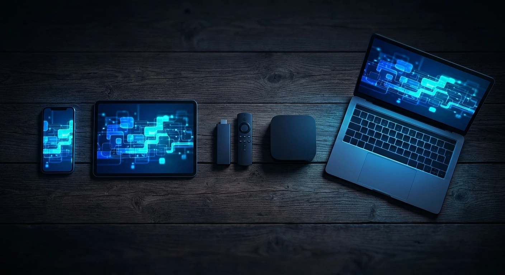
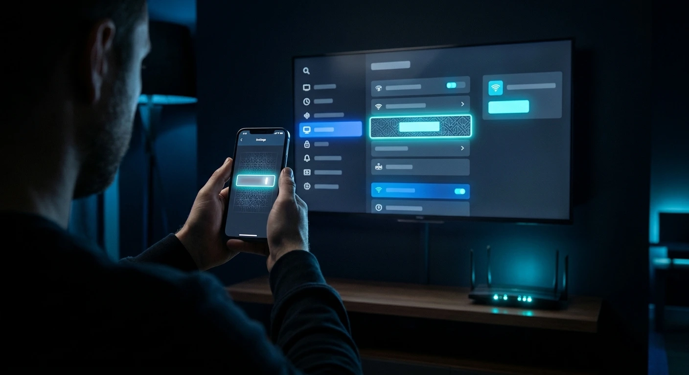

**How to activate Net IPTV in short: you choose a plan, open the welcome email that arrives within about 60 seconds of payment, install a player app on your device, and sign in with the details from that email or send support your device's MAC address.** On most devices the whole process takes under five minutes, and you don't need any technical knowledge to get it right.

This guide covers every device we support, in the order most people set them up: Smart TVs, Fire TV Stick, Android and iOS, MAG boxes, and Windows or macOS. It also covers the five most common causes of an "it isn't working" moment, so you can fix them yourself in a minute. If you prefer to see the short version per device first, our [supported devices page](/devices) has quick step lists for each platform. For a provider-neutral overview of login types and player apps, see our [complete IPTV setup guide](/blog/how-to-set-up-iptv), and if IPTV is new to you, start with [what IPTV is](/blog/iptv-guide).

## Quick questions

- [What do I need before I start?](#what-you-need-before-you-start)
- [Which player app should I use?](#which-player-app-to-use-on-each-device)
- [What if the activation email doesn't arrive?](#fixing-the-5-most-common-activation-problems)
- [Can I use it on two TVs?](#activating-net-iptv-on-more-than-one-device)

## What you need before you start

To activate Net IPTV you need three things: an active plan or trial, the welcome email with your login details, and a compatible device on a connection of at least 8 Mbps. Gather them first and the setup itself rarely takes more than five minutes on any screen in the house.

- **A plan or a trial.** Choose a 1, 3, 6 or 12-month plan on the pricing page, or ask support for a free trial on WhatsApp. A trial is set up exactly like a paid account, so everything in this guide applies to both.
- **Your welcome email.** It contains your username, password and setup links. Depending on your device you'll use either the login details, a portal URL, an M3U playlist link, or none of them (MAC-based apps).
- **A supported device.** Samsung and LG Smart TVs, Android TV and Google TV, Amazon Fire TV Stick, Apple TV, iPhone and iPad, Android phones and tablets, MAG boxes, Windows and macOS computers, and Xbox and PlayStation.
- **Enough bandwidth.** About 8 Mbps per stream for HD, 15 Mbps for Full HD and 25 Mbps for stable 4K. The player adapts the bitrate automatically, so a slower line lowers quality rather than stopping playback.

Keep your phone nearby. On several devices, the quickest route is to send a photo of the TV screen to support on WhatsApp.

## How to activate Net IPTV (step by step)

Activating Net IPTV follows the same five steps on every device: get your plan, open the welcome email, install a player, sign in or send your MAC address, and load the channels and TV guide. Only step four changes between devices, and the sections below cover each one.

1. **Choose a plan or start a trial.** Pick your plan on the pricing page, or message support for a trial with no card details.
2. **Open the welcome email.** After payment confirmation, an automated email with your login details and a setup guide is sent, usually within 60 seconds. Save it, because you'll need it again when you add a second device.
3. **Install a player.** Each device uses a different player app, covered in the next section.
4. **Sign in or send your MAC address.** Either type the details from the email into the app, or send support the MAC address the app displays so they can link the playlist to your device.
5. **Load the channels and guide.** Restart the app. Live channels, films and series appear in separate sections, and the TV guide (EPG) loads with the playlist.

## Which player app to use on each device

Net IPTV works through a player app installed on your device. The right player depends on the platform: MAC-based apps on Smart TVs and phones, a login-based player on Fire TV Stick, the built-in portal on MAG boxes, and VLC or MyIPTV Player on computers.

| Device | Player | How you activate | Typical time |
|---|---|---|---|
| Samsung / LG Smart TV | Smart IPTV or IBO Player | Send support the MAC address | 3 min |
| Amazon Fire TV Stick | Player linked in your welcome email | Username and password | 4 min |
| Android and iOS | IBO Pro Player or IBO Player | Send MAC address and device ID | 2 min |
| MAG box | Built-in portal | Portal URL from your email | 5 min |
| Windows / macOS | VLC or MyIPTV Player | M3U playlist link | 5 min |

Player apps are made by independent developers, and some charge a small activation fee for their premium features. That fee goes to the app developer, not to Net IPTV, and it is separate from your subscription.

## Smart TV: Samsung and LG

On Samsung and LG Smart TVs, Net IPTV is activated by MAC address. You install a player from the TV's own app store, the app shows a MAC address on first launch, and support links your playlist to that address. Samsung (Tizen) and LG (webOS) work the same way.

1. Open the app store on your TV and install **Smart IPTV** or **IBO Player**.
2. Launch the app and note the **MAC address** shown on screen. A photo with your phone is the easiest way to avoid typos.
3. Send that MAC address to support on WhatsApp or live chat.
4. Once support confirms, restart the app. Your full channel list loads automatically.

If the TV shows a different MAC address after a software update or a factory reset, send the new one to support and they will move your playlist.

## Amazon Fire TV Stick

The Fire TV Stick doesn't use a MAC address. Instead you allow apps from outside the Amazon Appstore, install the player through the Downloader app using the link in your welcome email, and sign in with your username and password. It works on the Fire TV Stick, Fire TV Stick 4K and 4K Max.

1. Go to **Settings → My Fire TV → Developer Options** and enable apps from unknown sources (on newer models, allow it for the Downloader app).
2. Install **Downloader** from the Amazon Appstore.
3. Open Downloader and enter the link from your welcome email to install the player.
4. Open the player and sign in with your **username and password**.
5. Pick a category and start watching.

If Developer Options isn't visible, open **Settings → My Fire TV → About** and select the device name several times until a message confirms developer mode is on.

## Android and iOS phones and tablets

On Android and iPhone or iPad, activation takes about two minutes. You install IBO Pro Player or IBO Player from Google Play or the App Store, then send support a screenshot showing your MAC address and device ID, and support adds the playlist to your device for you.

1. Install **IBO Pro Player** or **IBO Player** from Google Play or the App Store.
2. Open the app and take a screenshot of the screen showing the **MAC address and device ID**.
3. Send the screenshot to support.
4. The library syncs in a few seconds and is ready on Wi-Fi or mobile data.

On mobile data, keep an eye on usage: an hour of HD uses several gigabytes. Lowering the quality in the player's settings stretches a data allowance much further.

## MAG box, Windows and macOS

MAG boxes connect through a portal URL, and computers use an M3U playlist link; both are in your welcome email. These setups take slightly longer, around five minutes, because the portal or playlist has to load fully the first time.

**MAG box (MAG 524, 544 and similar):**

1. Go to **Settings → Servers → Portals**.
2. Enter the portal URL from your welcome email.
3. Reboot the box so the portal refreshes.
4. Channels, films and series appear under separate tabs.

**Windows and macOS:**

1. Install [VLC](https://www.videolan.org/vlc/) or MyIPTV Player.
2. Load the **M3U playlist link** from your welcome email (in VLC: *Media → Open Network Stream*).
3. Wait for the playlist to load. Large libraries can take a minute the first time.

## Activating Net IPTV on more than one device

You can install the player on as many devices as you like, but the number you can watch on at the same time depends on your plan. The monthly plan includes one connection, the 3- and 6-month plans include two, and the annual plan includes four.

Set up each extra device exactly as described above, using the same welcome email. For MAC-based apps, send support each device's MAC address. Credentials are meant for your own household; using more streams than your plan includes at once may lead to a temporary suspension, so add connections rather than stretching one. You can compare connections per plan on the pricing page before upgrading.

## Fixing the 5 most common activation problems

Most activation problems come down to one of five causes: the email went to spam, the MAC address was mistyped, the details were copied with an extra space, the TV guide needs a refresh, or the Wi-Fi is too weak for the chosen quality. Each one takes a minute to fix.

1. **No welcome email.** Check spam and promotions first. If it hasn't arrived within five minutes, message support with the email address you used at checkout and they'll resend it.
2. **MAC address not recognised.** MAC addresses mix the digits 0 and 1 with the letters O and I easily. Send a photo of the screen rather than typing it out.
3. **"Invalid login" on Fire TV or computers.** Copy-pasting can add a space at the start or end of the username or password. Type them by hand, matching upper and lower case exactly.
4. **Empty TV guide.** The EPG loads automatically with the playlist. If it looks empty, refresh the EPG from the player's settings and set the correct time zone, which fixes it in almost every case.
5. **Buffering in 4K.** Switch the TV to 5 GHz Wi-Fi or a network cable, or drop to Full HD. 4K needs about 25 Mbps for each stream.

If a single channel stops working, report its name on live chat. Most outages are upstream and come back within minutes, and backup sources are kept for major channels.

## What to do after activation

Once you're watching, three settings make daily use noticeably better: set your favourite channels, check the 7-day catch-up on major channels, and confirm the audio and subtitle language. Each takes a moment, works the same way in every player app, and saves you time every evening once your Net IPTV subscription is running.

- **Favourites.** Most players let you star channels so they appear first, which helps with a line-up of 22,000+ live channels.
- **Catch-up.** Major channels carry 7-day catch-up, so you can scroll back through the guide and play anything from the past week.
- **Audio and subtitles.** Multi-language audio and subtitles are available on many channels and titles; switch them from the player's playback menu.

Any other question is probably answered in our [FAQ](/faq), and support is available around the clock on [WhatsApp or live chat](/contact).

## Conclusion

Activating Net IPTV comes down to the welcome email, the right player for your device, and either a sign-in or a MAC address sent to support. That covers Smart TVs, Fire TV Stick, Android, iPhone, MAG boxes and computers, usually in under five minutes. If you haven't chosen a plan yet, compare them on the [pricing page](/pricing), or ask for a free trial and run through this guide on your own TV first.
